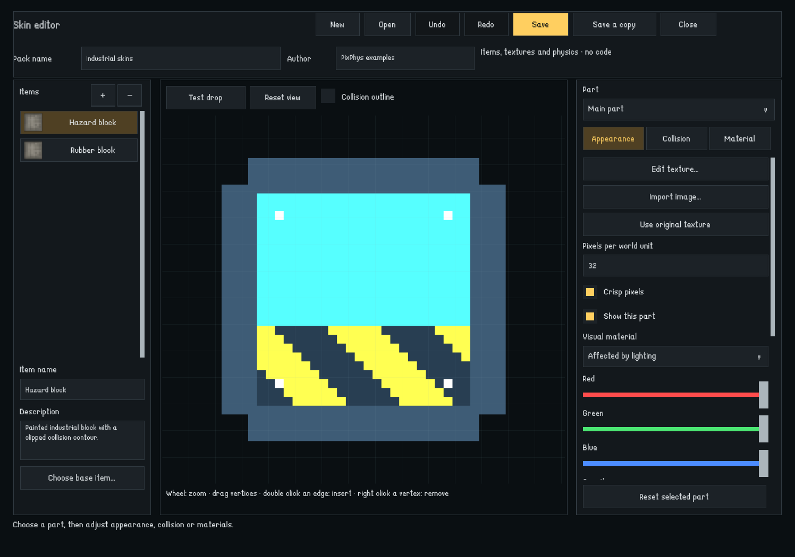
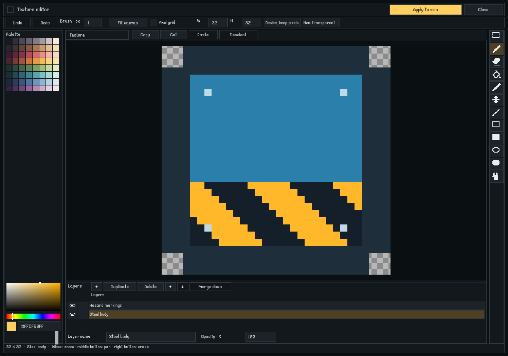
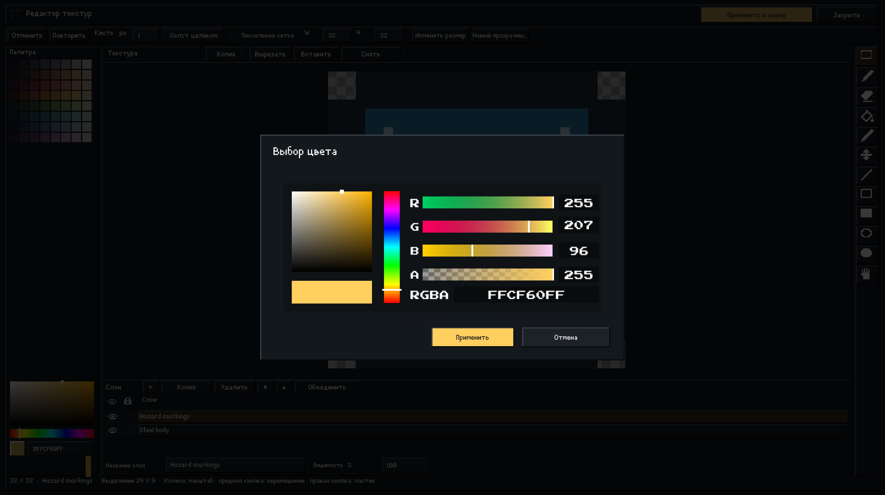
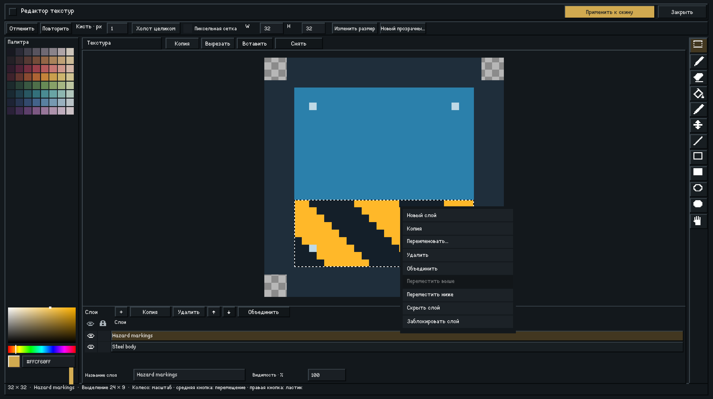

# Редактор скинов предметов

Скины создаются внутри игры без программирования. Это варианты встроенных предметов: они выбираются в **Toybox → Скин**, рядом с вариантом **Оригинал**, и не регистрируются как отдельные детали каталога. В разных быстрых слотах можно хранить одну основу с разными скинами. Ограничение «только для верстака» остаётся свойством основы.

Текстурпак необязателен для постройки из мастерской. Постройка сохраняет обычную деталь, ссылку на скин и снимок коллизии, масштаба и физических настроек. Без набора используется исходное оформление; геометрия, масса и материал сохраняются. После установки и одобрения подходящего набора оформление автоматически появляется и у уже загруженных деталей, без повторного изменения физики.

## Создать набор

1. В главном меню откройте **Модификации → Создать → Открыть редактор скинов**. Имя можно задать уже в редакторе.
2. Введите название набора и автора. Слева выберите **Выбрать основу…** и нужный встроенный предмет. Поиск работает по названию предмета.
3. При необходимости добавьте другие скины кнопкой **+**. У каждого своя основа, название, описание и настройки частей. В одном наборе — до 64 скинов.
4. Выберите часть справа. Например, корпус и колесо составного предмета можно оформить по-разному. Сброс части возвращает все её исходные настройки.

## Внешний вид

**Загрузить текстуру…** открывает файловый диалог игры. Поддерживаются PNG с прозрачностью и JPEG. Изображение копируется в пакет: исходный файл на компьютере больше не нужен. При импорте сохраняется приблизительная ширина исходного спрайта; размер можно уточнить параметром **Пикселей на единицу мира**.

Можно выбрать цвет и прозрачность, ввести код цвета `#RRGGBBAA`, изменить масштаб по двум осям, отражение, видимость и сглаживание. Материал отрисовки бывает исходным, с освещением и без освещения. Для материала с освещением доступна собственная карта нормалей. Кнопки исходной текстуры и карты нормалей возвращают ресурсы выбранной основы.

Масштаб части меняет и её физическую геометрию. Коллизия настраивается отдельно и не меняется автоматически при замене изображения.

## Коллизия

Доступны исходная форма, прямоугольник, круг, капсула, многоугольник и отсутствие твёрдой коллизии. Смещение, размеры, радиус и направление капсулы задаются численно. Исходные служебные триггеры предмета сохраняются.

Для многоугольника:

- Перетаскивайте вершины в предпросмотре; координаты выбранной вершины можно ввести справа.
- Дважды щёлкните по ребру в нужном месте: новая вершина будет вставлена на этом ребре. Щелчки по пустому месту не меняют контур. Кнопка **Добавить вершину** вставляет точку между выбранной и следующей вершиной.
- Нажмите правой кнопкой на вершине для удаления; также есть кнопка удаления.
- **Контур по изображению** строит выпуклую оболочку непрозрачных пикселей импортированной текстуры. Затем её можно поправить вручную. Для вогнутой формы двигайте вершины самостоятельно.

**Привязка вершин к пикселям** включена по умолчанию. Перетаскивание и ввод координат выравнивают вершины по границам пикселей выбранного спрайта с учётом его точки опоры. Для свободного редактирования отключите привязку. На диагональном ребре вставка выравнивает точку по ближайшей пиксельной границе вдоль основной оси и сохраняет положение на ребре. При достаточном увеличении видна пиксельная сетка. Уже сохранённые вершины не перемещаются при включении привязки.

Разрешено от 3 до 64 вершин. Самопересечения и вырожденные формы не сохраняются. Целое перетаскивание отменяется одним действием.

## Встроенный редактор текстур

Во вкладке **Внешний вид** нажмите **Редактировать текстуру…**. Можно рисовать поверх текущего изображения, в том числе исходного игрового спрайта, не меняя его файл или настройки импорта.

Рабочее окно использует компактную компоновку: палитра из 64 цветов слева, большой холст в центре, одна колонка пиксельных иконок инструментов справа и таблица слоёв под холстом. Наведение на инструмент показывает его название и клавишу в строке состояния. Под палитрой постоянно доступны поле насыщенности/яркости, полоса оттенка, текущий цвет, hex и прозрачность; используется встроенный режим существующего игрового Color Picker. Щелчок по образцу синхронизирует цвет без добавления действия в историю рисунка. Размер кисти, отмена, повтор, подгонка, сетка, размеры текстуры и её изменение находятся в верхней строке. Шахматный фон ограничен изображением, пространство вокруг него однотонное; пиксельная сетка по умолчанию выключена.

- **Карандаш** рисует выбранным цветом; размер кисти задаётся в пикселях.
- **Ластик** делает пиксели прозрачными. Правая кнопка мыши временно работает как ластик.
- **Заливка** заменяет цвет связанной области, сохраняя границы других цветов.
- **Пипетка** выбирает цвет пикселя вместе с прозрачностью. Цвет также задаётся каналами RGBA и кодом `#RRGGBBAA`.
- Щелчок по текущему цвету открывает существующий HSV/RGBA Color Picker игры: поле насыщенности/яркости, оттенок, RGB, альфа и hex. Изменения сразу видны в цвете кисти; **Отмена** возвращает прежний цвет. Выбор цвета не меняет историю рисунка.
- Колесо меняет масштаб вокруг указателя, средняя кнопка перемещает холст. **Холст целиком** возвращает исходный вид; пиксельную сетку можно включить в верхней строке.
- **Изменить размер** сохраняет имеющиеся пиксели от верхнего левого угла, а дополнительное место оставляет прозрачным. **Новый прозрачный холст** очищает изображение с указанными размерами. Оба действия можно отменить.

Каждый мазок, фигура, перемещение выделения или операция со слоем — одно действие в общей истории текстуры. Поддерживаются Ctrl/Cmd+Z, Ctrl/Cmd+Shift+Z и Ctrl/Cmd+Y; история ограничена 32 действиями и 64 МиБ снимков и удерживаемых буферов. Правки остаются рабочей копией до **Применить к скину**. Закрытие изменённого рисунка предлагает применить его, не применять или продолжить работу.

Применение создаёт собственную PNG-текстуру набора и одно отменяемое изменение документа скина. Внешний файл и исходный предмет не меняются. При изменении размера изображения сохраняется его прежняя ширина в игровом мире; коллизия остаётся прежней. Для записи модификации на диск после рисования нажмите обычное **Сохранить** в редакторе скинов.

### Слои

Панель слоёв находится под холстом. Верхняя строка списка рисуется поверх нижних. Щёлкните по имени для выбора слоя; отдельные колонки с глазом и замком переключают видимость и блокировку любого слоя, сохраняя текущий выбор. Доступны добавление, копия, удаление, перемещение вверх/вниз и объединение с нижним слоем. Имя и непрозрачность выбранного слоя задаются под списком. Блокировка защищает пиксели слоя от рисования и удаления выделения; скрытый слой тоже не рисуется. Копия слоя содержит независимые пиксели.

Перетаскивайте строку слоя за имя, чтобы изменить порядок. Жёлтая линия показывает место вставки; у верхнего и нижнего края длинного списка включается автопрокрутка. Отпускание вне списка или Esc отменяет перенос. Завершённое перемещение — одно действие отмены/повтора.

Двойной щелчок по имени открывает ввод прямо в строке: Enter или щелчок вне поля подтверждает имя, Esc отменяет. Пустые имена и имена длиннее 64 символов не принимаются. Правая кнопка открывает меню слоя с созданием, копией, переименованием, удалением, объединением, перемещением, видимостью и блокировкой. Недоступные операции отключены; Esc и щелчок вне меню закрывают его без изменения рисунка.

Цвета интерфейса совпадают с игровыми панелями: тёмный фон, светлый текст и жёлтый акцент. Цвета образцов палитры сохранены.

До 32 слоёв разрешено при суммарном размере всех слоёв не более 16 мегапикселей. Изменение размера сохраняет верхний левый угол каждого слоя. **Новый прозрачный холст** создаёт один пустой слой, а отмена возвращает прежний стек.

После применения и сохранения рядом с итоговой PNG остаётся редактируемый файл `Sources/<hash>.skintex`. Повторное открытие восстанавливает имена, порядок, видимость, блокировки, прозрачность и пиксели слоёв. Во время игры предмет использует обычную PNG. Импорт другого изображения или выбор исходной текстуры заменяет многослойный рисунок; это изменение можно отменить до сохранения.

### Выделение, буфер и фигуры

**Выделение** задаёт прямоугольную область с пунктирной границей. Карандаш, ластик, заливка и фигуры меняют только её пиксели на активном слое. **Копия** копирует активный слой; Ctrl/Cmd+Shift+C копирует видимый результат всех слоёв. **Вырезать**, **Вставить** и Delete сохраняют альфа-канал. Буфер общий для окон редактора в текущем запуске игры. Вставка располагает изображение в выделенной области либо по центру холста и включает инструмент сдвига; выходящие за границу пиксели обрезаются.

Инструмент **Сдвиг** перемещает пиксели внутри выделения перетаскиванием. Стрелки сдвигают их на пиксель, Shift+стрелки — на десять. **Снять** или Ctrl/Cmd+D снимает выделение, Ctrl/Cmd+A выделяет весь холст.

Инструменты **Линия**, **Рамка**, **Эллипс** и их залитые варианты показывают результат до отпускания кнопки мыши. Shift ограничивает фигуру квадратом/кругом, а линию — шагом 45°. Ctrl/Cmd строит прямоугольник или эллипс от центра. Esc отменяет текущий жест, затем снимает выделение; закрытие окна происходит, когда активного жеста и выделения нет.

### Горячие клавиши

Основные сочетания соответствуют [инструментам Aseprite](https://www.aseprite.org/docs/drawing/) и [модификаторам рисования](https://www.aseprite.org/docs/keyboard-shortcuts/). Они действуют только в редакторе текстур и не срабатывают при вводе текста или выборе цвета в диалоге.

| Клавиша | Действие |
| --- | --- |
| B (также P), E, G, I | Карандаш, ластик, заливка, пипетка |
| M, V, L, H | Выделение, сдвиг, линия, перемещение холста |
| U / повторное U | Прямоугольник / залитый прямоугольник |
| Shift+U / повторное Shift+U | Эллипс / залитый эллипс |
| Alt+щелчок | Временно выбрать цвет видимого пикселя |
| Space+перетаскивание | Временно перемещать холст |
| Ctrl/Cmd+C, X, V | Копировать, вырезать, вставить |
| Ctrl/Cmd+Shift+C | Копировать результат всех видимых слоёв |
| Ctrl/Cmd+A, D | Выделить всё, снять выделение |
| Delete / Backspace | Очистить выделение на активном слое |
| Ctrl/Cmd+Shift+N, Ctrl/Cmd+J | Новый слой, копия слоя |
| [ / ], − / + | Уменьшить / увеличить кисть |
| 1–6 | Масштаб 100–600% |
| Ctrl/Cmd+' | Переключить пиксельную сетку |
| Ctrl/Cmd+Z, Shift+Ctrl/Cmd+Z (также Ctrl/Cmd+Y) | Отменить, повторить |
| Enter, Esc | Завершить жест; отменить жест / снять выделение / закрыть |
| Ctrl/Cmd+S | Применить текстуру к скину |

## Материал и проверка

Включите **Изменить физический материал**, чтобы выбрать готовый игровой материал. Для своих значений включите **Свои параметры материала**: трение, упругость, плотность, теплопроводность, теплоёмкость, горючесть, температуры и электропроводность. Массу можно задать отдельно. Иначе при изменении физического материала масса пересчитывается по плотности и площади заменённой коллизии.

**Тест падения** проверяет форму и контакт с полом в отдельной физической сцене. Это геометрический тест: составной предмет ведёт себя как одно твёрдое тело. Шарниры, двигатели, горение и другие игровые скрипты в предпросмотре не запускаются. Полную работу предмета проверяйте после сохранения в игре. Колесо мыши меняет масштаб, **Сбросить вид** возвращает предмет в исходное положение.

## Сохранение и публикация

**Сохранить** создаёт локальную модификацию в папке `GameData/Modifications`. Варианты появляются в списке **Скин** соответствующих деталей в Toybox. Повторное сохранение обновляет оформление без перезапуска. Физические настройки уже построенных деталей сохраняются; новые размещения используют текущие настройки выбранного варианта.

**Сохранить копию** создаёт самостоятельный пакет без чужого идентификатора мастерской. Для редактирования существующего набора используйте его контекстное меню **Редактировать скины** либо **Открыть** в редакторе и выберите его `Modification.json` или `Skin.json`. Набор из мастерской сохраняется локальной копией, в том числе при открытии через файловый диалог. Собственный опубликованный набор в `GameData/Modifications` сохраняет папку и идентификатор мастерской для обновления публикации.

Публикация выполняется через контекстное меню модификации и обычное подтверждение загрузки в мастерскую. Для собственной локальной версии, сохранённой редактором, игра записывает одобрение её точного содержимого. Полученный от другого автора или изменённый пакет проходит обычную проверку версии перед включением.

Горячие клавиши: **Ctrl/Cmd+S** — сохранить, **Ctrl/Cmd+Z** — отменить, **Ctrl/Cmd+Y** — повторить, **Esc** — закрыть окно или текущий диалог. При закрытии, открытии другого набора и создании нового редактор предлагает сохранить несохранённые изменения. История хранит последние 32 действия и очищается после сохранения.

## Формат и ограничения

Пакет содержит `Modification.json` (`Runtime: "skin"`, `ApiVersion: 1`, `Scripts: []`), редактируемый `Skin.json`, изображения `Textures/`, необязательные редактируемые слои `Sources/*.skintex`, миниатюры `Previews/` и `Thumbnail.png`. Поле `LayerSource` части связывает редактируемые слои с итоговой текстурой; старые скины без этого поля открываются одним слоем. Скрипты, сборки, произвольные компоненты и изменение файлов других модов этим форматом не выполняются. Поведение встроенного предмета сохраняется, поэтому этот формат подходит для оформления и физических вариантов существующих предметов; новые алгоритмы поведения создаются через Lua API.

Ограничения: 64 предмета, 64 настроенные части на предмет, 64 вершины на контур, до 8 МиБ на изображение, не более 8192 пикселей по стороне и 16 мегапикселей суммарно для текстур набора, до 1 МиБ на `Skin.json`. Импортированные изображения в рабочем сеансе ограничены 64 МиБ. Для повторного редактирования сохраняйте папку набора целиком.

Оформление связывается по `ProjectId` набора и `Id` варианта, а для опубликованного набора учитывается идентификатор мастерской. Перенос локальной папки и установка того же набора из мастерской не создают новую базовую деталь. «Сохранить копию» выдаёт новый `ProjectId`, сохраняя внутренние `Id` вариантов. Неоднозначные старые копии не подставляются случайным образом.

Сохранения построек версии 2 содержат необязательную ссылку `Skin` у обычного `PropID`. В `Vehicle.json` отдельно перечисляются `RequiredParts` и `OptionalSkins`; набор скинов не становится обязательной деталью. Физический снимок не содержит изображений или произвольных файловых путей.

Если отсутствуют сами детали или логические узлы, игра показывает список и предлагает отменить загрузку либо открыть **неполную копию**. Недоступные детали и узлы, связанные с ними шарниры, провода и служебные соединения удаляются из копии. Исходный файл не меняется, копия требует «Сохранить как». Для известных публикаций доступны ссылки на мастерскую.

Постройки версий 0 и 1 продолжают читаться. Прежние сохранения со скинами как отдельными предметами преобразуются при открытии с установленным исходным набором; следующее сохранение записывает обычную основу и необязательный скин. Без старого набора прежний формат не содержит сведений об основе, поэтому такая запись показывается в списке отсутствующих деталей. В новых сохранениях состояние модовых компонентов отделено от списка деталей: недоступный мод можно пропустить без исполнения его кода. После изменения иерархии основы в обновлении игры редактор может потребовать заново настроить части.

Редактируемый источник ограничен 32 МиБ, 32 слоями и 16 мегапикселями суммарно по слоям; каждый внутренний PNG — не более 8 МиБ. Для всего набора также действует отдельная суммарная квота 16 мегапикселей редактируемых слоёв. Имена, размеры и длины блоков проверяются до декодирования. Итоговая текстура остаётся обычной PNG, версия документа скина — 1.

Существующие C#- и Lua-модификации продолжают использовать свои форматы. Возможности редактора не требуют перевода старых модификаций на формат скинов.

## Сборка редактора

Редактор находится в `Assets/Scripts/SkinEditor/` и компилируется через `PixPhys.SkinEditor.asmdef` в отдельную сборку `PixPhys.SkinEditor`. В неё входят документ, история изменений, геометрические инструменты, пиксельный холст, предпросмотр и uGUI-интерфейс. Она не ссылается на `Assembly-CSharp`.

`ISkinEditorHost` и `ISkinProject` задают границу с игрой. Адаптер `SkinEditorGameHost` в игровой сборке предоставляет каталог, физические параметры, ввод, навигацию, файловый диалог и включение сохранённого пакета; `SkinProjectStore` реализует хранение пакета. Загрузка скинов во время игры остаётся в `SkinRuntime`. Схема `Skin.json` версии 1, пространства имён и GUID существующих скриптов сохранены, поэтому старые скины и ссылки prefab продолжают работать.

### Проверки

`SkinVariantTests` / `SkinEditorTests` проверяет прежние пакеты и сохранения, `SkinEditingToolsTests` — пиксельную сетку, вставку на ребро, рисование, заливку, историю, чтение спрайтов и границы сборки. В открытом Editor без несохранённой игровой сессии их можно запускать обычным EditMode test runner.

`SkinEditorVerification.VerifyEditingInteractions` проверяет кнопки и жесты в Play Mode на отдельной временной копии окна. При необходимости передайте каталог примера IndustrialSkins. `RunAssertions` позволяет выполнить синхронные проверки без остановки открытого редактора; две проверки Lua, ожидающие немедленного удаления объектов в Edit Mode, в Play Mode заменяются `VerifyDeferredCandidateCleanup`, который ждёт следующий кадр. Эти средства не публикуют модификации.

`SkinTextureWorkspaceAuthoring.Upgrade` дополняет существующий `SkinTextureEditor.prefab` слоями, выделением и инструментами, сохраняя прежние привязки контролов. `SkinEditorThemeAuthoring.Apply` создаёт базовую компоновку; при повторном запуске после него последовательно выполните `SkinTextureWorkspaceAuthoring.Upgrade`, `SkinTextureReferenceAuthoring.Apply` и `SkinTextureLayerAuthoring.Apply`. Эти шаги задают компактную компоновку, пиксельный шрифт с кириллицей, встроенный выбор цвета, жесты и меню слоёв, а затем цвета игрового UI. Пиксельные иконки собраны из обычных uGUI-элементов; палитра использует сериализованные события RGBA-ползунков. Для работы готовых prefab инструменты из `Tools/Unity` не требуются.

`SkinTextureDocument` хранит слои, выделение, композицию и общую историю; `SkinPixelCanvas` сохраняет снимки изменённых тайлов. `SkinRasterShapes` рассчитывает геометрию фигур, а `SkinTextureShortcuts` переводит клавиши в команды без зависимости от устройств ввода игры. `SkinLayerFile` проверяет и сохраняет ограниченный бинарный источник с PNG слоёв. `ISkinLayerProject` дополняет хранение без изменения прежнего `ISkinProject`; `ISkinEditorColorPickerHost` подключает всплывающий игровой Color Picker через адаптер, а необязательный `ISkinEditorInlineColorPickerHost` — встроенный режим того же компонента. Встроенные экземпляры имеют собственное состояние и не занимают глобальное всплывающее окно; при закрытии временного окна восстанавливается предыдущий игровой экземпляр. Эти границы сохраняют независимость сборки редактора от `Assembly-CSharp`.

`SkinEditorThemeVerification.Verify` проверяет клики по всем 64 образцам через обработку мыши Unity, соответствие цвета и поля RGBA, подключения инструментов, локализацию и размещение панелей при 1280×720 и 1024×576. Проверка создаёт отдельное временное окно, ждёт его отрисовки и записывает результат в JSON. `Capture` снимает пример IndustrialSkins для иллюстрации инструкции, не используя несохранённый рисунок пользователя.

`SkinTextureWorkspaceTests` проверяет смешанную историю слоёв и пикселей, композицию альфа-канала, ограничения выделения, буфер, перекрывающийся перенос, симметрию фигур, источник слоёв, квоты, сохранение пакета и сочетания клавиш. `SkinTextureWorkspaceVerification.Verify` дополнительно выполняет жесты и команды в игре, проверяет встроенный и всплывающий режимы Color Picker, их синхронизацию, независимость состояний, восстановление прежнего игрового экземпляра, границы градиента, блокировку невыбранного слоя с отменой, подтверждение/отмену цвета и повторное открытие слоёв. `Capture` делает отдельный снимок рабочего окна или выбора цвета. Пример IndustrialSkins содержит независимые слои Steel body и Hazard markings.

`SkinTextureLayerAuthoring.Apply` добавляет жесты, встроенное переименование, контекстное меню и цвета `GameplayUITheme`, сохранённые в prefab без зависимости отдельной сборки от игровой. `SkinTextureLayerPanel` управляет временным состоянием жестов и меню, `SkinTextureLayerGesture` передаёт события указателя. Строки `SkinTextureLayerRow` обновляются без пересоздания при выборе слоя. `SkinTextureDocument.ReorderLayer` сохраняет активный слой и записывает один шаг истории.

`SkinTextureLayerVerification.Verify` проверяет перенос и Undo/Redo, Esc и отпускание вне списка, ввод имени, все девять команд через клики Unity, ограничения меню, размещение у краёв экрана, автопрокрутку и границу сборки.

Компоновка сверена с [документацией рабочего пространства Aseprite](https://www.aseprite.org/docs/workspace/) и [реализацией основного окна](https://github.com/aseprite/aseprite/blob/main/src/app/ui/main_window.cpp). Иконки и интерфейс реализованы средствами проекта.

`SkinPackPipelineVerification.Verify` проходит полный путь в Play Mode из главного меню: создание набора, выбор основы, рисование слоёв, отмена и повтор применения, импорт PNG/JPEG и карты нормалей через файловый диалог, редактирование коллизии и физики, тест падения, сохранение и регистрация предметов, сохранение/восстановление конструкции, создание копии, обновление и повторное открытие слоёв. Проверка отдельно открывает внешний набор мастерской через `Skin.json` и проверяет сохранение локальной копии, затем загружает обновлённый пакет, восстанавливает прежнюю конструкцию и проверяет неизменяемую копию файлов для загрузки в мастерскую. Кнопки проверяются через UI raycast и события указателя. Запускайте без открытого пользовательского редактора и файлового диалога; результат записывается в `PixPhys-skin-pack-pipeline.json` во временной папке ОС. Созданные проверкой пакеты, регистрации и решения доверия удаляются; публикация в мастерскую не выполняется.

`SkinVariantVerification.Verify` проверяет в Play Mode настоящий список скинов Toybox, независимые быстрые слоты, размещение с обычной идентичностью детали, загрузку без текстурпака и восстановление оформления после установки. Проверяются отмена и принятие неполной копии, очистка шарнира и защита исходного файла. Отчёт — `PixPhys-skin-variants.json` во временной папке ОС.
## Установка зависимостей при открытии постройки

В предупреждении об отсутствующих деталях или скинах нажмите «Установить недостающее». Игра подпишется на указанные публикации Steam Workshop, покажет прогресс и проверит загруженные наборы. Для каждой новой версии потребуется подтверждение её возможностей; загрузка файлов сама по себе не разрешает запуск кода. Уже разрешённые версии подключаются повторно без дополнительного запроса.

После подключения всех доступных наборов постройка открывается автоматически без перезапуска игры. Если часть публикаций удалена, недоступна или пропущена при проверке, предупреждение покажет оставшиеся зависимости: можно повторить установку, открыть неполную копию или отменить действие. Наборы без идентификатора Workshop нужно установить вручную. Отмена или смена исходного проекта прекращает автоматическое открытие; Steam может завершить загрузку уже запрошенных файлов.

Новые Lua- и C#-моды подключаются в текущем сеансе. Уже исполняемая другая версия мода с кодом не заменяется на лету: её обработчики могут использоваться текущими объектами. Скины из наборов без кода допускают обновление без перезапуска. Закреплённые зависимости подключаются в правильном порядке и только при совпадении проверенной версии.

Проверка: `WorkshopDependencyTests` проверяет изоляцию загрузки от запуска кода, отмену, ошибки отдельных публикаций, порядок зависимостей и источники деталей/нод. `Tools/Unity/WorkshopDependencyVerification.cs` проверяет настоящие окна и подключение Lua, C# и скинов с тестовым источником загрузки; подписки Steam при этой проверке не изменяются.

